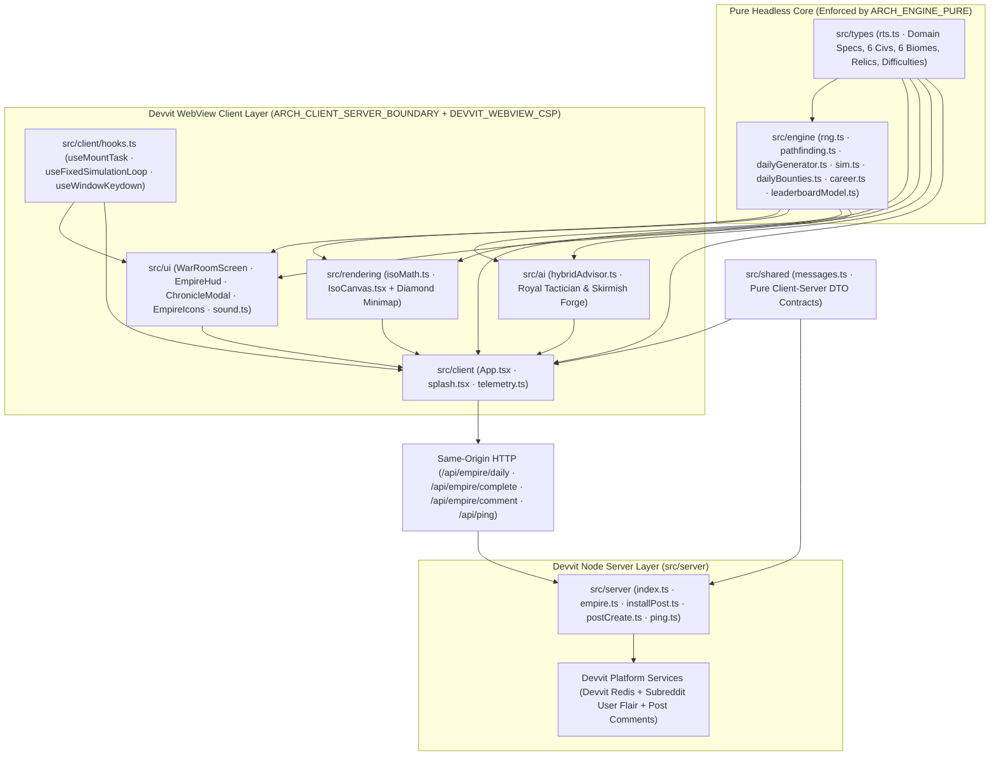
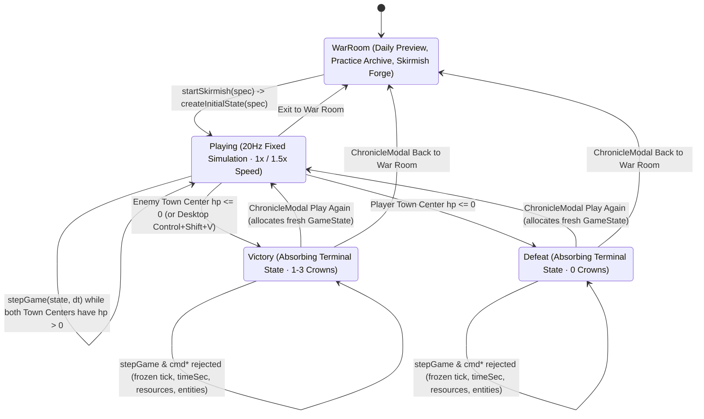
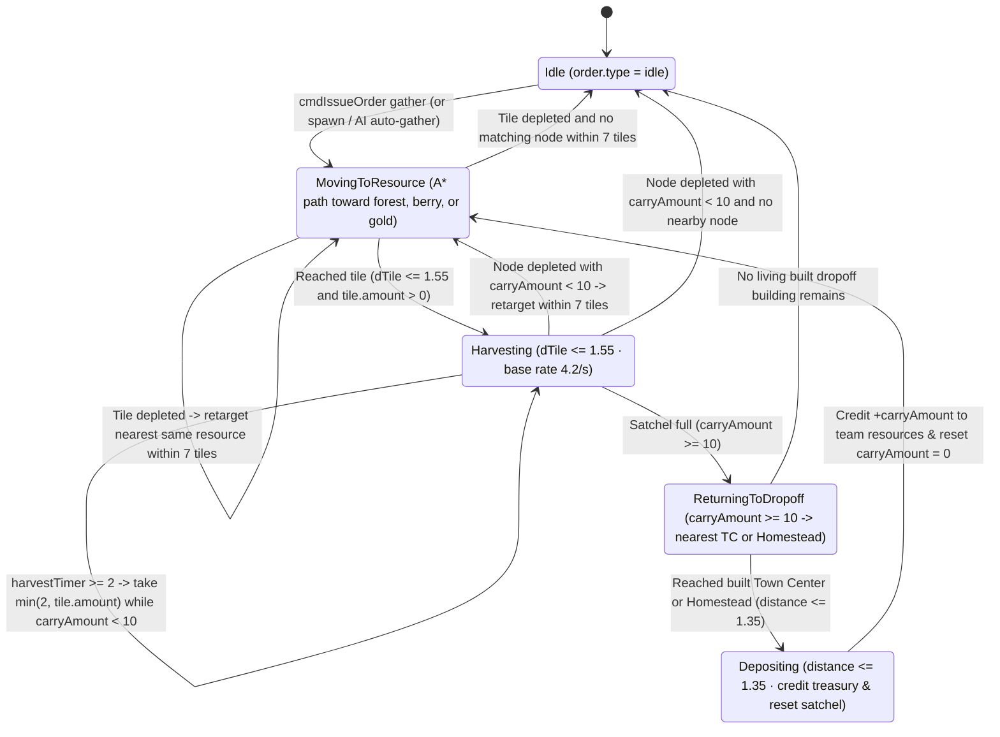
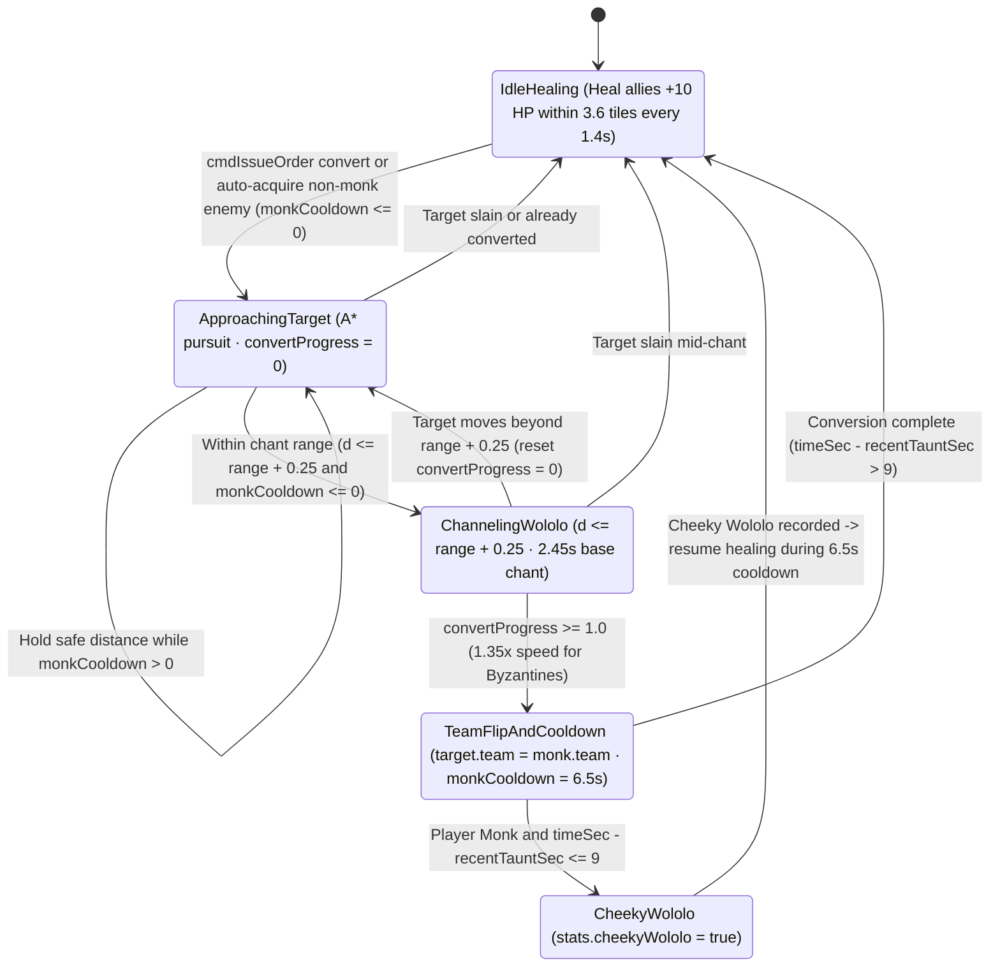

# Pocket Empires — Formal Architecture, Boundary Map & Simulation Statecharts

> **High-Trust Agent Engineering Playbook — Section 4.B:** Formal State Visualization, Execution Boundaries, and Deterministic Static Gates for **Pocket Empires** on Reddit Devvit Web.

---

## 1. Inverted Trust Pyramid Overview

Pocket Empires is structured around the **Inverted Trust Pyramid** so that correctness, determinism, and Devvit platform compliance are enforced mechanically rather than by manual inspection alone:

| Trust Layer | Surface Area | Verification Harness | Guarantees Enforced |
|---|---|---|---|
| **Layer 1 — Human Taste & Playfeel** | Narrowest (Top) | Golden visual review & live playtest (`--screenshots <dir>`) | Tactile *Age of Empires II* stone-and-brass readability, crisp pacing, and audio/visual punch |
| **Layer 2 — Deterministic Static & Type Gates** | Medium | `npm run typecheck` + `node scripts/check-invariants.mjs` | **8 zero-dependency architectural rules** enforcing engine purity, client/server isolation, WebView CSP, repo isolation, zero tofu glyphs, zero timing hacks, zero raw `useEffect` in product UI, and Devvit deployment manifest alignment |
| **Layer 3 — Automated Property & Runtime Verification** | Broadest (Base) | `npm test` (`tests/*.test.ts`, `tests/property.test.ts`), `npm run verify:levels`, `node scripts/verify-runtime.mjs` | 50-seed 180°-symmetry (tiles, resources, Sacred Relics) & bidirectional A* fuzzing, 300-tick command fuzzing across absorbing terminal states, 30-day level solvability, and real Chromium desktop/mobile/splash E2E flows with mounted Redis API routes and `0` console/page errors |

---

## 2. Execution Boundary Graph (`flowchart TD`)

Unidirectional module dependencies strictly separate the **pure headless 20 Hz RTS engine** (`src/types` + `src/engine`) from **WebView client presentation & local AI** (`src/rendering`, `src/ui`, `src/ai`, `src/client`) and **Devvit server persistence** (`src/server`). Cross-runtime communication crosses only same-origin `/api/empire/*` routes typed via `src/shared/messages.ts`.

### Key Boundary Contracts
- **`src/types` -> `src/engine`:** Pure TypeScript data structures and deterministic `stepGame(state, dt)` / `cmd*` transitions. Zero imports from `react`, `@devvit/*`, DOM APIs, or upper layers.
- **`{src/rendering, src/ui, src/ai, src/client}`:** Reads `GameState` snapshots and issues deterministic `cmd*` mutations. Product `.tsx` modules never call raw `useEffect` or `setTimeout`; lifecycle orchestration is centralized in `src/client/hooks.ts`, Canvas animations use `requestAnimationFrame`, and local `window.LanguageModel` probing uses a single bounded timeout inside `src/ai/hybridAdvisor.ts`.
- **`/api/empire/*` -> `src/server`:**
  - `GET /api/empire/daily?date=YYYY-MM-DD` loads top-15 Redis daily standings, Imperial Hall of Fame, community telemetry, and active player streak/rank.
  - `GET /api/empire/leaderboard?date=YYYY-MM-DD` serves the unified 3-League Leaderboard Hub (Today's Siege, Imperial Hall of Fame, Raid Citadels).
  - `POST /api/empire/complete` atomically updates `empire:daily:{date}:stats`, `empire:daily:{date}:board`, `empire:player:{username}`, and `empire:hall_of_fame` (anti-crown-farming protected), then awards dynamic Subreddit User Flair (`👑 Siege Victor` / `🧙 Wololo Lord`) via `reddit.setUserFlair`.
  - `POST /api/empire/comment` posts spoiler-free War Chronicles to the Reddit thread via `reddit.submitComment` guarded by an idempotency key (`empire:comment:{postId}:{date}:{username}`).

---

## 3. Match Lifecycle Statechart (`stateDiagram-v2`)

Every siege progresses from the **War Room** (`screen === 'war_room'`) into active **20 Hz deterministic simulation** (`outcome === 'playing'`) and terminates in one of two **mathematically absorbing terminal states** (`victory` or `defeat`).

### Terminal-State Absorption Invariants (Verified by `tests/property.test.ts`)
- Once `applyBuildingHit` reduces either empire's `town_center` to `hp <= 0`, `state.outcome` transitions to `'victory'` or `'defeat'`.
- Within any single `GameState` instance, `victory` and `defeat` are **strictly absorbing**:
  - `stepGame(state, dt)` returns immediately when `state.outcome !== 'playing'`, freezing `timeSec`, `tick`, `resources.player`, `resources.enemy`, `units.length`, and `buildings.length`.
  - `cmdPlaceBuilding`, `cmdTrainUnit`, and `cmdIssueOrder` immediately return `null` / `false` without mutating treasury or entity arrays.
  - `tests/property.test.ts` fuzzes **200+ post-terminal ticks** with randomized `cmd*` calls across 12 campaigns to prove terminal outcomes never revert or drift.

---

## 4. Villager Economy Statechart (`stateDiagram-v2`)

Villagers (`kind === 'villager'`) drive the 3-resource economy (**Wood** from `forest`, **Food** from `berry`, **Gold** from `gold`) with automatic node retargeting and nearest drop-off pathfinding to built `town_center` or `homestead` structures.

### Economy Rates & Modifiers
- **Base Harvest Rate:** `4.2` progress/sec (`2` resource units extracted each time `harvestTimer >= 2`, filling a `10`-unit satchel in `~2.38s`).
- **Royal Decree Modifiers:** `gold_fever` boosts Gold harvest rate by `+45%`; `timber_boom` boosts Wood harvest rate by `+45%` and construction speed by `+35%`.
- **Node Depletion:** When `tile.amount <= 0`, the tile deterministically converts to walkable `'grass'` (`maxAmount = 0`), opening new forest siege lanes cleanly on the blocked grid.

---

## 5. Monk `Wololo!` Conversion Statechart (`stateDiagram-v2`)

Monks (`kind === 'monk'`) combine passive aura healing with classic *Age of Empires* single-target faith conversion (`WOLOLO!`), unlocking the **Cheeky Wololo** accolade when timed alongside **Taunt 30 (`30 — Wololo!`)**.

### Faith & Accolade Rules
- **Civilization & Decree Synergies:** **Byzantines** Monks gain `+25 HP` and `convertSpeedMult = 1.35` (`~1.81s` chant instead of `2.45s`). Under **Age of Wololo (`wololo_sabbath`)**, Monasteries and Monks cost `30%` less and every player conversion awards `+50 Gold`.
- **`CheekyWololo` Trigger (`timeSec - recentTauntSec <= 9`):** Sounding Taunt `30` (`cmdTriggerTaunt(state, '30')`) stamps `state.recentTauntSec = state.timeSec`. Completing a player Monk conversion within `9` simulation seconds sets `state.stats.cheekyWololo = true`.

---

## 6. Deterministic Static Invariant Rules (`scripts/check-invariants.mjs`)

All **7 static & architectural rules** execute in `< 100ms` with zero external dependencies and emit root-cause remediation instructions (`[RULE_ID] file:line — <what failed>. Fix: <approved pattern>`):

| # | Rule ID | Scope Checked | Invariant Enforced | Approved Pattern / Remediation |
|---|---|---|---|---|
| **1** | `ARCH_ENGINE_PURE` | `src/types/*`, `src/engine/*` | Forbids importing `src/client/`, `src/ui/`, `src/rendering/`, `src/ai/`, `src/server/`, `react`, `react-dom`, or `@devvit/*` | Keep domain types and 20 Hz simulation 100% pure and headless-testable; exchange plain data via `src/types/rts.ts` |
| **2** | `ARCH_CLIENT_SERVER_BOUNDARY` | `src/client/*`, `src/ui/*`, `src/rendering/*`, `src/ai/*` | Forbids importing `src/server/*`, `@devvit/web/server`, or `@devvit/analytics/server` into browser bundles | Share pure DTO contracts via `src/shared/messages.ts` and invoke server endpoints via relative `fetch("/api/...")` |
| **3** | `DEVVIT_WEBVIEW_CSP` | `src/client/*`, `src/ui/*`, `src/rendering/*`, `src/ai/*` | Forbids external `fetch("http://...")`, `fetch("https://...")`, or protocol-relative `fetch("//...")` calls | Route all HTTP traffic through same-origin `/api/*` endpoints in `src/server/index.ts` or run local inference in `src/ai/hybridAdvisor.ts` |
| **4** | `REPO_ISOLATION` | `src/**`, `README.md`, `GAME_SPEC.md` | Enforces zero occurrences of external cloud/SDK brand tokens outside the Devvit Web stack | Persist data exclusively in Devvit Redis (`src/server/empire.ts`) and keep AI counsel inside `src/ai/hybridAdvisor.ts` |
| **5** | `ZERO_TOFU_GLYPHS` | `src/ui/*.tsx`, `src/rendering/*.tsx`, `src/client/*.tsx`, `src/engine/sim.ts` (`addCallout`) | Forbids raw Unicode `\p{Extended_Pictographic}` emojis in WebView JSX or 2D Canvas callouts (preventing Linux/WebView `□` tofu boxes) | Render crisp vector heraldry with `<EmpireIcon />` and `<CivCrest />` (`src/ui/EmpireIcons.tsx`) and sanitize dynamic strings with `stripEmoji()` |
| **6** | `NO_SLOP_COMMENTS_OR_TIMING_HACKS` | All `src/**` (comments + `setTimeout(`) | Bans `HACK`, `WORKAROUND`, `FIXME`, and `DO NOT DELETE` comments across `src/`, and bans `setTimeout(` across `src/engine/*`, `src/rendering/*`, `src/client/*`, and `src/ui/*` (permitting only bounded local-model timeout in `src/ai/hybridAdvisor.ts`) | Advance gameplay timers deterministically in `stepGame(state, dt)` (`src/engine/sim.ts`) and drive UI/Canvas transitions via `requestAnimationFrame` or CSS animations |
| **7** | `NO_RAW_USE_EFFECT_IN_PRODUCT` | `src/ui/*.tsx`, `src/client/App.tsx`, `src/client/splash.tsx` | Forbids importing or calling `useEffect` directly inside product UI components and app entrypoints | Compute derived state synchronously during render, or use vetted lifecycle primitives in `src/client/hooks.ts` (`useMountTask`, `useFixedSimulationLoop`, `useWindowKeydown`) |
| **8** | `DEVVIT_PRODUCTION_CONTRACT` | `devvit.json`, `package.json`, `src/server/index.ts` | Validates Reddit Devvit deployment entrypoints, `redis`/`reddit` permissions, menu/trigger routes, and full client+engine `typecheck` script | Keep `devvit.json`, `src/server/index.ts`, and `package.json` `typecheck` strictly synchronized before `npx devvit upload` |
